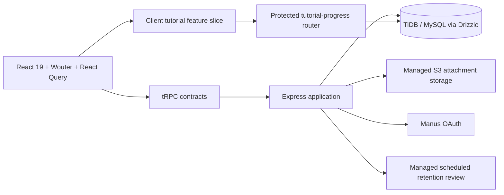

# Control Ledger — IT GRC Evidence Portfolio

Control Ledger is an evidence-led IT GRC portfolio and working control-assurance hub. It demonstrates how regulatory intent can be translated into named technology controls, managed evidence, reproducible test conclusions, remediation, risk decisions, and accountable administration. The public portfolio explains the model; the authenticated workspace runs a simulated but functional operating workflow.

> **Scope boundary:** all portfolio scenarios are academic, independent research, or simulated case-study material. The application does not claim certification, legal applicability, client work, or a live production assurance conclusion.

## What the application supports

| Area | Included capability |
|---|---|
| Control assurance | Evidence intake, managed attachments, analyst testing, findings, remediation, risk acceptance, and control status. |
| Audit preparation | Simulated PBC tracker, workpapers, policy pack, role-assignment audit ledger, and CSV export. |
| Decision support | Governance dashboard, executive risk briefing, Recharts visualizations, and FlowGuard technical-evidence evaluation. |
| Administration | Workspace duties, bulk local-user assignment, retention templates, review schedules, private saved audit views, notification preferences, and immutable accountability events. |
| Guided use | In-site walkthrough, contextual help links, first-time administrator checklist, and private signed-in tutorial progress. |
| Integration boundaries | Optional GitHub remediation preparation, Grafana webhook design, read-only Google Directory discovery, and queued Gmail reminder delivery. |

## Architecture at a glance



The project follows a **tRPC-first** contract model. React pages call typed procedures, server routers enforce authentication and administrative boundaries, and Drizzle helpers keep SQL persistence out of UI code. Route pages are lazy-loaded behind a shared fallback so public entry does not eagerly ship every workspace, chart, PDF, and administrative surface. Managed evidence files live in S3; the database stores lifecycle and provenance metadata rather than file bytes.

## Repository map

| Path | Responsibility |
|---|---|
| `client/src/pages/` | Route-level portfolio, workspace, dashboard, administration, and tutorial screens. |
| `client/src/components/` | Shared presentation elements and the existing UI component library. |
| `client/src/features/tutorial/` | Tutorial step model and contextual help link. New bounded features should prefer this ownership pattern. |
| `client/src/lib/` | Client-only utilities such as safe audit CSV generation and the tRPC client. |
| `server/routers/` | tRPC contracts and authorization boundaries. |
| `server/features/tutorial/` | Private tutorial-progress persistence for the tutorial feature slice. |
| `server/controlAssuranceDb.ts` | Current operational data layer for evidence, roles, retention, notification, and remediation workflows. It remains intentionally intact pending a separately tested domain split. |
| `server/*Provider*.ts` and integration adapters | Optional provider boundaries for FlowGuard, Grafana, GitHub, Google Directory, and Google Workspace mail. |
| `drizzle/schema.ts` and `drizzle/*.sql` | Drizzle schema declarations and reviewed, ordered database migrations. |
| `shared/` | Cross-layer domain models and presentation calculations that must agree between client and server. |
| `docs/` | Implementation notes, activation boundaries, validation records, and architecture decisions. |

## Feature-slice convention

The repository does **not** perform a risky full-directory rewrite. Instead, it adopts an incremental feature-slice convention for bounded new capability:

```text
client/src/features/<feature>/      # client model and reusable feature UI
server/features/<feature>/          # server-only persistence or domain service
server/routers/<feature>.ts         # stable tRPC contract
```

The tutorial feature is the reference implementation. Its step metadata and help-link construction are owned by `client/src/features/tutorial/`, while the user's private progress record is owned by `server/features/tutorial/`. Route paths and tRPC procedure names remain stable. The trade-off analysis and rationale are recorded in [`docs/architecture-upgrade-decision.md`](docs/architecture-upgrade-decision.md).

## Local development

The project uses Node.js, pnpm, React, Express, tRPC, Drizzle, and Vitest. A managed deployment supplies the database, OAuth, storage, notification, and application environment variables.

```bash
pnpm install
pnpm dev
```

The development server uses the existing OAuth and database configuration. Do not commit `.env` files, access tokens, OAuth client secrets, refresh tokens, storage credentials, or webhook secrets.

### Quality checks

```bash
pnpm test        # full Vitest suite
pnpm check       # TypeScript without emit
pnpm build       # production client and server build
pnpm verify      # test, type-check, and build in delivery order
```

The repository’s [quality workflow](.github/workflows/quality.yml) runs a frozen pnpm install and `pnpm verify` on pull requests and pushes to `main`. Package overrides and the Wouter patch live in `pnpm-workspace.yaml`, which is the pnpm 10-compatible location for shared workspace configuration.

### Database changes

Schema changes are additive unless a separately reviewed migration is approved. Update `drizzle/schema.ts`, generate a migration, review the generated SQL, and apply it through the managed database migration workflow. Do not use destructive statements without a data-impact review.

```bash
pnpm drizzle-kit generate
# Review the newly generated drizzle/<sequence>_<name>.sql file.
```

The `db:push` script exists for compatible local environments. In the managed project, use the reviewed migration SQL through the approved schema-change workflow so the schema and migration history stay aligned.

## Security and operating boundaries

| Boundary | Implementation rule |
|---|---|
| Authorization | Template administrators retain all workspace actions. Workspace duties are `control_owner`, `grc_analyst`, and `risk_approver`; administrative procedures remain guarded server-side. |
| Evidence files | File bytes are managed in S3. Database records contain metadata, retention state, provenance, and scoped retrieval references only. |
| Retention | Expiry can revoke access without deleting accountable lifecycle metadata. Legal holds affect retention handling. |
| Trace intake | FlowGuard evaluates accepted JSON formats but does not persist the raw trace payload; it retains a bounded summary, evidence hash, verdict, and exception handoff. |
| Google Workspace | Directory discovery and queued Gmail readiness are server-side only. Browser UI never accepts or renders OAuth client secrets or refresh tokens. |
| Email reminders | Opted-in email reminders are queued with metadata-only counts. Delivery remains OAuth-pending until approved server-side values and a verified authorization are supplied. |
| Scheduling | Retention review uses the managed Heartbeat callback after production activation. Do not add in-process timers or `node-cron`. |
| Provenance | ISO, PCI, NIST, BI/OJK, and cloud mappings remain evidence-reference context, not certification or legal conclusions. |

## Deferred integration activation

Google Workspace and Gmail delivery are deliberately prepared but inactive. When an administrator approves activation, configure server-side project secrets rather than creating a browser credential form. The activation guide in [`docs/google-workspace-oauth-activation.md`](docs/google-workspace-oauth-activation.md) records the intended scope and safety boundary.

Grafana webhook intake is also intentionally inactive until a server-side HMAC secret is supplied. See [`docs/grafana-webhook-integration-notes.md`](docs/grafana-webhook-integration-notes.md) before enabling it.

## Maintainability roadmap

The next candidate for an incremental slice is the administrator configuration domain. It should be split only after role assignment, retention, notification, saved-view, and Directory-delivery contracts are tested as a bounded module. The evidence, testing, findings, and remediation lifecycle should remain together until a transaction boundary is explicitly designed and validated.

For the decision matrix behind this approach, read [`docs/architecture-upgrade-decision.md`](docs/architecture-upgrade-decision.md).
